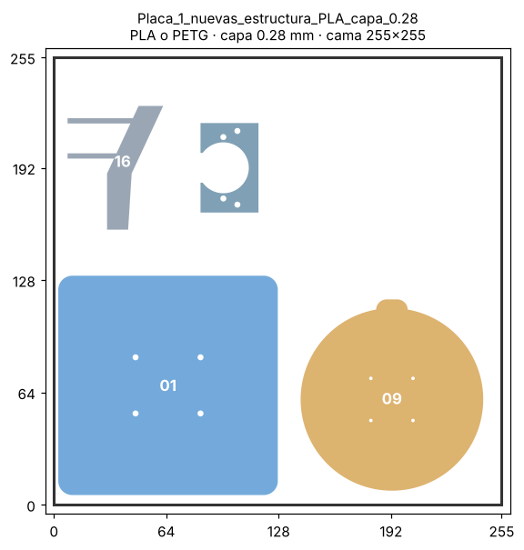
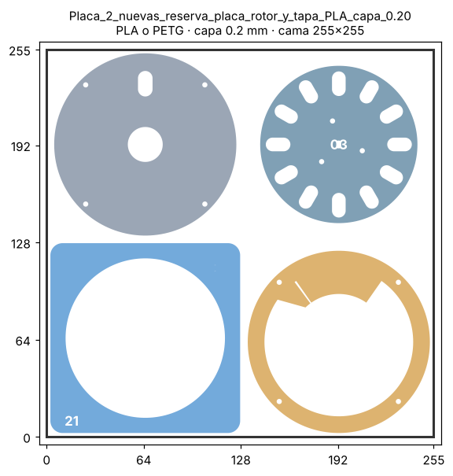

# Impresión por placas: cama de 255 × 255 mm

Aquí están todas las piezas del Pastillero V4 agrupadas en placas listas para imprimir. Las piezas ya están giradas en su orientación de impresión y colocadas en la cama. Entre piezas hay al menos 5 mm y al borde 2.5 mm; se comprobó con la silueta real de cada una.

Con **2 placas** se imprime todo el pastillero, y todo en PLA o PETG: ya no hay piezas de TPU.

| Placa | Piezas | Material | Capa | Alto máx. |
|---|---|---|---|---|
|  **1 · Estructura** | 01 carcasa, 09 tapa de llenado, 16 rampa de salida, 10 bancada del 28BYJ-48, 06 cono | PLA / PETG | **0.28 mm** | 92 mm |
|  **2 · Mecanismo y tapa** | 21 tapa de servicio (con alojamiento del pulsador), 07 reserva (con techo, separadores y barredor), 02 placa con canal, 03 rotor para eje D5 | PLA / PETG | **0.20 mm** | 76 mm |

## Si ya imprimiste V3: `Solo_piezas_nuevas/`

Con el motor 28BYJ-48 cambia el rotor 03 (su eje es Ø5 de doble plano y está descentrado). De V3 se reutilizan el **cono 06**, que es idéntico, y la **bancada 10**, que tiene la misma base que la V4: encima lleva un **puente 11 nuevo** para el 28BYJ-48 (7 cm³ en vez de los 42 de la bancada V4). En la carpeta [`Solo_piezas_nuevas/`](Solo_piezas_nuevas/) están las 2 placas sin el cono y con el puente en lugar de la bancada:

| Placa | Piezas | Capa | Alto máx. |
|---|---|---|---|
|  **1 · Estructura** | 01 carcasa, 09 tapa de llenado, 16 rampa de salida, 11 puente del 28BYJ-48 para la bancada V3 | **0.28 mm** | 92 mm |
|  **2 · Reserva, placa, rotor y tapa** | 21 tapa de servicio, 07 reserva con barredor, 02 placa con canal, 03 rotor para eje D5 | **0.20 mm** | 76 mm |

Para montar la bancada V3 con el puente nuevo, mira [la sección del LEEME](../LEEME_V4.md#si-ya-imprimiste-la-bancada-10-de-v3); usa los 2 M3×12 y las tuercas del puente 11 viejo. No reutilices de V3 el rotor 03, el puente 11 viejo, la placa 02, el canal 17 ni la tapa 09: cambiaron y no encajan con el 28BYJ-48, la rampa o la tapa de servicio. Las piezas de pesaje de V3 (12 a 16 y la celda) ya no se usan.

## Archivos de cada placa

- **`.3mf`** (recomendado): cada pieza es un objeto independiente y ya está colocado. Ábrelo en Bambu Studio, OrcaSlicer, PrusaSlicer o Cura. Si el programa pregunta, elige cargar solo la geometría.
- **`.stl`**: la placa entera en un solo archivo. Si tu programa lo carga como un solo objeto, usa "Dividir en objetos" (*Split to objects*) para ajustar cada pieza.
- **`.png`**: vista superior de la distribución.
- **`Resumen_placas.json`**: lista de piezas, alto máximo y volumen sólido de cada placa.

Las piezas sueltas también están en `../STL/`, por si hay que reimprimir solo una.

## Cómo se ahorró tiempo

1. **Menos placas.** Con 2 impresiones se cubren las 9 piezas.
2. **Capa según la función.** La placa 1 lleva piezas de estructura sin holguras críticas, así que va a 0.28 mm: unas 30 % menos capas que a 0.20. La placa 2 lleva las piezas con holguras finas (la reserva, que fija el hueco del disco con su faldón de separadores, el disco y la placa) y la tapa, que se ve mejor a 0.20 mm.
3. **Sin cambio de material.** El barredor rígido de la reserva sustituye al peine de TPU.
4. **Sin soportes.** Todas las piezas están orientadas para imprimirse sin soportes: la carcasa sobre su base nervada; la placa 02, la reserva 07, la bancada 10 y las tapas 21 y 09 boca abajo; y la rampa 16 de pie sobre un costado.

## Ajustes sugeridos

- **Rígidas:** boquilla 0.4, 3 perímetros, relleno 15–20 % en gyroid o rejilla y **sin soportes**. Para la carcasa basta con 2 perímetros si quieres ir aún más rápido.
- **Rampa 16 (placa 1):** ponle un borde (*brim*) de 5 mm porque se imprime de pie sobre un costado. Las líneas de capa quedan a lo largo de la pendiente y ayudan a que la pastilla resbale.
- **Tapa de servicio 21 (placa 2):** el alojamiento del pulsador 6×6 queda hacia arriba al imprimirla boca abajo. Comprueba que el pulsador entre justo; si queda flojo, una gota de pegamento lo fija.
- **Rotor 03 y reserva 07:** activa la compensación de *pata de elefante* (0.15–0.2 mm) en el laminador. El disco tiene 1 mm de holgura a los separadores y 0.6 mm arriba y abajo; con esa compensación no debería rozar. Si aun así roza, lija el borde del disco.
- **Antes de imprimir:** revisa en el laminador que ninguna pieza haya quedado flotando o girada. Los STL ya vienen apoyados en z = 0.

## Para regenerar las placas

```
cd ../Codigo_CAD
python armar_placas.py
```

Las posiciones están en el diccionario `PLACAS` al inicio de `armar_placas.py`. Si cambias una pieza, el script vuelve a comprobar que nada se encima y que todo cabe en 255 × 255.
