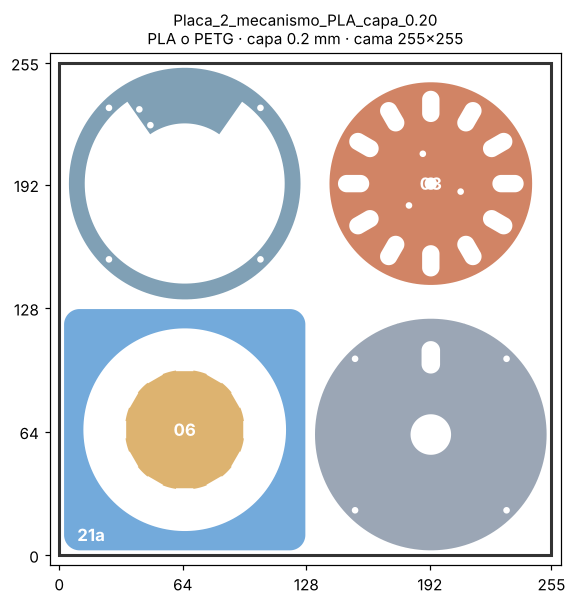
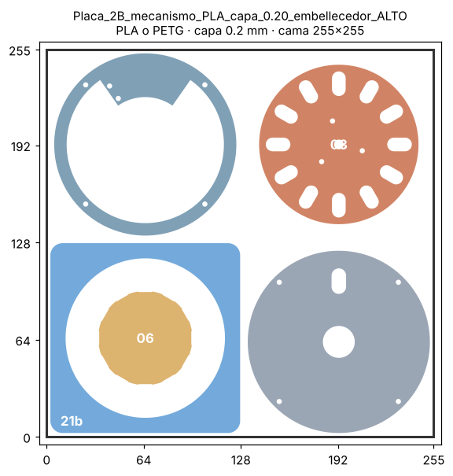
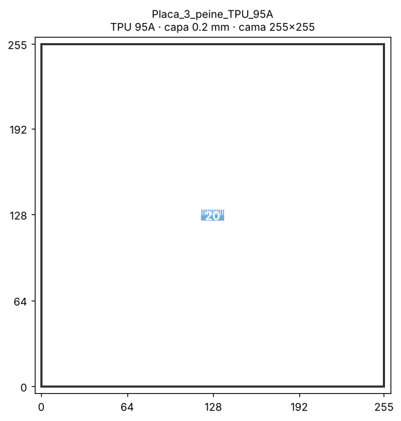

# Impresión por placas: cama de 255 × 255 mm

Aquí están todas las piezas del Pastillero V4 agrupadas en placas listas para imprimir. Las piezas ya están giradas en su orientación de impresión y colocadas en la cama. Entre piezas hay al menos 5 mm y al borde 2.5 mm; se comprobó con la silueta real de cada una.

Con **3 placas** se imprime todo el pastillero: placa 1, placa 2 **o** 2B, y placa 3.

| Placa | Piezas | Material | Capa | Alto máx. |
|---|---|---|---|---|
|  **1 · Estructura** | 01 carcasa, 07 reserva, 09 tapa, 10 bancada, 16 bandeja inclinada, 11 puente, 13 mordaza | PLA / PETG | **0.28 mm** | 92 mm |
|  **2 · Mecanismo** | 21a embellecedor corto (con el cono 06 dentro de su hueco), 02 placa con canal, 04 aro, 03 rotor | PLA / PETG | **0.20 mm** | 43 mm |
|  **2B · Mecanismo (embellecedor alto)** | Igual que la 2, pero con el 21b alto. **Imprime la 2 o la 2B, no las dos.** | PLA / PETG | **0.20 mm** | 84 mm |
|  **3 · Peine** | 20 peine flexible | **TPU 95A** | 0.20 mm | 8 mm |

## Archivos de cada placa

- **`.3mf`** (recomendado): cada pieza es un objeto independiente y ya está colocado. Ábrelo en Bambu Studio, OrcaSlicer, PrusaSlicer o Cura. Si el programa pregunta, elige cargar solo la geometría.
- **`.stl`**: la placa entera en un solo archivo. Si tu programa lo carga como un solo objeto, usa "Dividir en objetos" (*Split to objects*) para ajustar cada pieza.
- **`.png`**: vista superior de la distribución.
- **`Resumen_placas.json`**: lista de piezas, alto máximo y volumen sólido de cada placa.

Las piezas sueltas también están en `../STL/`, por si hay que reimprimir solo una.

## Cómo se ahorró tiempo

1. **Menos placas.** Con 3 impresiones se cubren las 13 piezas.
2. **Capa según la función.** La placa 1 lleva piezas de estructura sin holguras críticas, así que va a 0.28 mm: unas 30 % menos capas que a 0.20. La placa 2 lleva las piezas con holguras finas (disco, cono, aro y placa del disco) y conviene dejarla a 0.20 mm.
3. **Huecos aprovechados.** El cono 06 se imprime dentro del hueco central del embellecedor, así que no ocupa sitio propio.
4. **Sin soportes.** Todas las piezas están orientadas para imprimirse sin soportes: la carcasa sobre su base nervada, la placa 02 y el aro 04 boca abajo, el embellecedor boca abajo y la bandeja 16 de pie.

## Ajustes sugeridos

- **Rígidas:** boquilla 0.4, 3 perímetros, relleno 15–20 % en gyroid o rejilla y **sin soportes**. Para la carcasa y la reserva basta con 2 perímetros si quieres ir aún más rápido.
- **Bandeja 16 (placa 1):** ponle un borde (*brim*) de 5 mm porque se imprime de pie. Las líneas de capa quedan a lo largo de la rampa y ayudan a que la pastilla resbale.
- **TPU:** 20–30 mm/s, retracción mínima y sin ventilador al máximo.
- **Antes de imprimir:** revisa en el laminador que ninguna pieza haya quedado flotando o girada. Los STL ya vienen apoyados en z = 0.

## Para regenerar las placas

```
cd ../Codigo_CAD
python armar_placas.py
```

Las posiciones están en el diccionario `PLACAS` al inicio de `armar_placas.py`. Si cambias una pieza, el script vuelve a comprobar que nada se encima y que todo cabe en 255 × 255.
