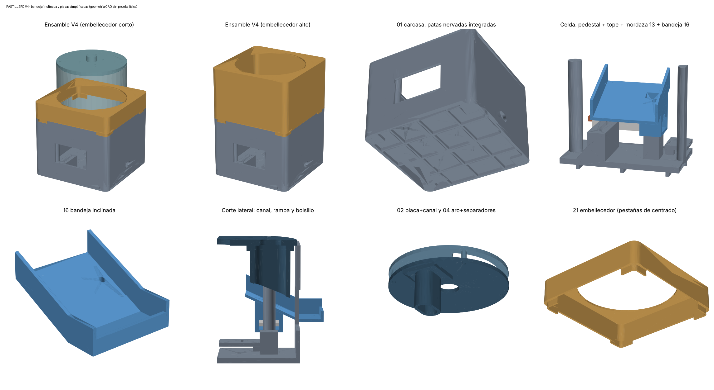

# Pastillero V4: piezas simplificadas

V4 parte de V3. El mecanismo de dosificación no cambia: rotor, cono, peine, techo, reserva y tapa son los mismos. Lo que cambia es la carcasa, la zona de la celda de carga y el número de piezas sueltas. Además se agrega un embellecedor y una bandeja inclinada que saca la pastilla por la ventana.

> **Para imprimir, ve directo a [`Impresion_255x255/`](Impresion_255x255/LEEME_IMPRESION.md).** Ahí están las 3 placas listas para una cama de 255 × 255.

## Carpetas

| Carpeta | Qué contiene |
|---|---|
| `Impresion_255x255/` | **Placas listas para imprimir** (.3mf, .stl y vista previa) y la guía de impresión |
| `STL/` | Cada pieza suelta, ya orientada, por si hay que reimprimir una |
| `STEP_piezas/` | Piezas en coordenadas de ensamble, para editar en CAD |
| `Pastillero_V4_ensamble.step` | Ensamble completo, con tornillería y referencias |
| `Referencias_NO_imprimir/` | Motor, eje, celda y tornillería nominales. **No se imprimen.** |
| `Codigo_CAD/` | Scripts que generan, validan y arman las placas, más `fuentes_V3/` con las piezas de V3 que se reutilizan |



## Qué cambió y por qué

| V3 | V4 | Motivo |
|---|---|---|
| 01 carcasa + 19 patas ×4 (pegadas) | **01 carcasa** con patas integradas | Las patas forman ahora una base nervada de 3 mm bajo el piso. Las celdas son de unos 28 mm, así que el piso se imprime como puentes cortos, sin soportes. Las cabezas de los tornillos quedan dentro de las celdas. |
| 12 pedestal (2 M3 al piso, se caía) | Pedestal **integrado en 01** | Va unido al piso y a la pared frontal y lleva un contrafuerte, así que ya no se puede caer. |
| no existía | **Segundo apoyo = tope de sobrecarga** integrado en 01 | Está debajo del extremo móvil de la celda, con 0.45 mm de holgura. No toca en uso normal: solo frena la bandeja si se aprieta o se golpea, para que la celda no se doble ni se suelte. (La celda tiene que quedar en voladizo para medir, por eso el segundo apoyo no la sujeta.) |
| 18 plataforma electrónica (4 M3) | Plataforma **integrada en 01** | Se conservan las ranuras para bridas y se agrega un paso de cable de 14×8 mm en la pared +X. |
| 13 mordaza (M3×16 desde arriba) | **13 mordaza con tuercas** | Los dos M3×30 entran **desde debajo de la carcasa**, con la cabeza alojada en el piso, y roscan en tuercas atrapadas en la 13. |
| 14 + 15 + 16 (3 piezas, 2 M3×20) | **16 bandeja inclinada de una pieza** | El fondo baja a **25°** hacia la ventana frontal y termina en un **bolsillo que sale 17.5 mm por fuera de la caja**. La pastilla resbala sola y se toma desde fuera sin meter la mano, y como sigue sobre la bandeja, se sigue pesando. Un manguito abraza el extremo móvil de la celda y se fija con 1 prisionero M3×10 que se aprieta desde dentro de la bandeja. |
| 17 canal | Boca del canal cortada en diagonal | Sigue la rampa con 10 mm de paso, para que la pastilla caiga y salga por debajo. |
| 02 placa + 17 canal (2 M3×8) | **02 placa con canal** | Se imprime con la cara superior de la placa sobre la cama, así queda lisa para el disco. |
| 04 aro + 05 separadores ×4 | **04 aro con separadores** | Se imprime boca abajo. Los separadores quedan alineados. |
| no existía | **21 embellecedor** (corto o alto) | Tapa la franja entre la carcasa y la reserva (placa, disco, aro y tornillos M3×30). Queda a ras de la carcasa, se centra con 4 pestañas en las esquinas y se coloca bajándolo por encima de la reserva, sin herramientas. Elige **una** versión: **21a corto** (hasta z=114) o **21b alto** (cubre también la reserva y queda a ras de su borde, con la tapa 09 accesible). |

Balance: de **25 piezas impresas → 13**, de **29 tornillos/prisioneros → 20** y de **29 tuercas → 20**.

## Piezas a imprimir

La forma más rápida es usar las **placas de [`Impresion_255x255/`](Impresion_255x255/LEEME_IMPRESION.md)**:

| Placa | Piezas | Capa |
|---|---|---|
| 1 · Estructura (PLA) | 01, 07, 09, 10, 11, 13, 16 | 0.28 mm |
| 2 · Mecanismo (PLA) | 21a + 06 (dentro del embellecedor), 02, 04, 03 | 0.20 mm |
| 2B · alternativa a la 2 | Igual, con el embellecedor alto 21b | 0.20 mm |
| 3 · Peine (TPU 95A) | 20 | 0.20 mm |

Estas piezas sueltas en `STL/` necesitan una orientación concreta:

| N.º | Pieza | Orientación |
|---|---|---|
| 01 | Carcasa con patas, pedestal, tope y plataforma | Base nervada sobre la cama. Sin soportes. |
| 02 | Placa inferior con canal | Placa abajo, canal hacia arriba. |
| 04 | Aro con techo y separadores | Boca abajo, separadores hacia arriba. |
| 16 | Bandeja inclinada | De pie sobre la cara del manguito, con borde (*brim*). |
| 21a / 21b | Embellecedor corto / alto | Boca abajo. Elige **uno**. |
| 20 | Peine | **TPU 95A**. |

## Tornillería

| Elemento | Cant. | Ubicación |
|---|---|---|
| M3×30 cabeza botón | 6 | 4 reserva/aro/placa/columnas; 2 mordaza 13 desde abajo de la carcasa |
| M3×12 cabeza botón | 9 | 4 bancada al piso; 2 puente motor; 3 cono al rotor |
| M3×8 cabeza botón | 2 | Peine flexible |
| Prisionero M3×6 | 2 | Cubo del rotor |
| Prisionero M3×10 | 1 | Bandeja 16 |
| Tuerca M3 (5.5 entre caras × 2.4) | 20 | |

## Armado

**El orden cambió:** el bloque de pesaje se monta **antes** que la bancada del motor, porque el bolsillo de la bandeja tiene que pasar por la ventana.

1. **Bloque de pesaje, fuera de la caja:**
   1. Mete una tuerca M3 en la ranura del manguito de la bandeja 16.
   2. Desliza el extremo móvil de la celda dentro del manguito hasta que quede a ras del extremo y aprieta el prisionero M3×10 desde dentro de la bandeja (llave Allen de 1.5 mm).
   3. Pon dos tuercas en los hexágonos de la mordaza 13 y desliza la mordaza entre la celda y el fondo de la bandeja, sobre el extremo fijo. Las tuercas quedan atrapadas.
2. **Meter el bloque en la carcasa:**
   1. Bájalo por arriba unos 2 cm más atrás de su sitio, para que el bolsillo pase por dentro de la pared.
   2. A la altura de la ventana, empújalo hacia el frente hasta que el bolsillo salga por la ventana y la celda apoye en el pedestal.
   3. Voltea la caja y aprieta los 2 M3×30 desde abajo.
3. **Motor:** baja la bancada 10 y fíjala al piso con 4 M3×12 desde abajo. Coloca el motor y el puente 11.
4. **Comprueba que la bandeja cuelga libre:** debe tener holgura visible con el tope, la mordaza, la bancada y los bordes de la ventana.
5. Pon la placa 02 (con su canal) y el conjunto rotor + cono, igual que en V3: cono y rotor con 3 M3×12, prisioneros al eje.
6. Monta el peine 20 sobre el aro 04 (2 M3×8). Coloca el aro, la reserva 07 y los 4 M3×30.
7. Baja el embellecedor 21 por encima de la reserva hasta que las pestañas entren en la carcasa. Pon la tapa 09.

## Verificación (solo geometría)

`Codigo_CAD/validar_v4.py` comprobó lo siguiente (resultado en `Verificacion_CAD_y_STL.json`):

- No hay choques entre piezas, referencias (motor, eje, celda) y tornillería con volumen mayor de 0.001 mm³, incluidas las dos variantes del embellecedor.
- El barrido completo del rotor y el cono no choca con nada. La holgura mínima es 0.20 mm, igual que en V3.
- Las holguras de la bandeja: 0.45 mm al tope de sobrecarga y a la mordaza, más de 2 mm a la bancada y a los bordes de la ventana.
- El canal queda 10 mm por encima de la rampa.
- El embellecedor queda a 0.5 mm de la placa, el aro y la reserva, y a 0.55 mm de las cabezas M3×30.
- Una pastilla acostada de 15×8×6 cae por el canal, se apoya en la rampa y baja libre hasta el bolsillo exterior.
- Los 14 STL son mallas cerradas, con orientación coherente y el mismo volumen y envolvente que el CAD.
- El bloque celda + mordaza + bandeja entra por arriba y por la ventana sin chocar, y después la bancada baja sin tocar la bandeja.

**Sin probar:** alimentación con carga, fricción, comportamiento del peine y calibración de la celda real. Los 25° de la rampa son una estimación para PLA contra un comprimido recubierto: si la pastilla no resbala, sube `SLOPE` en el generador. La celda 50×15×7 y el motor Ø32×25 siguen siendo referencias nominales. Confirma tu celda real antes de imprimir la bandeja y la mordaza.

## Pendiente conocido

La bancada 10 y el puente 11 siguen pensados para el motor nominal Ø32×25 con eje centrado. Si usas el **28BYJ-48**, hay que rediseñarlos (eje descentrado unos 8 mm), como indica `Firmware_ESP32/LEEME_FIRMWARE.md`.

## Regenerar

```
cd Codigo_CAD
pip install -r requirements.txt
python generar_pastillero_v4.py   # crea STL/, STEP_piezas/ y los json
python validar_v4.py              # choques, rotor, pastilla, montaje y mallas
python armar_placas.py            # placas de 255x255 en ../Impresion_255x255
```

Todo lo que necesitan los scripts está dentro de `Pastillero_V4/`; las piezas de V3 que se reutilizan están en `Codigo_CAD/fuentes_V3/`.
